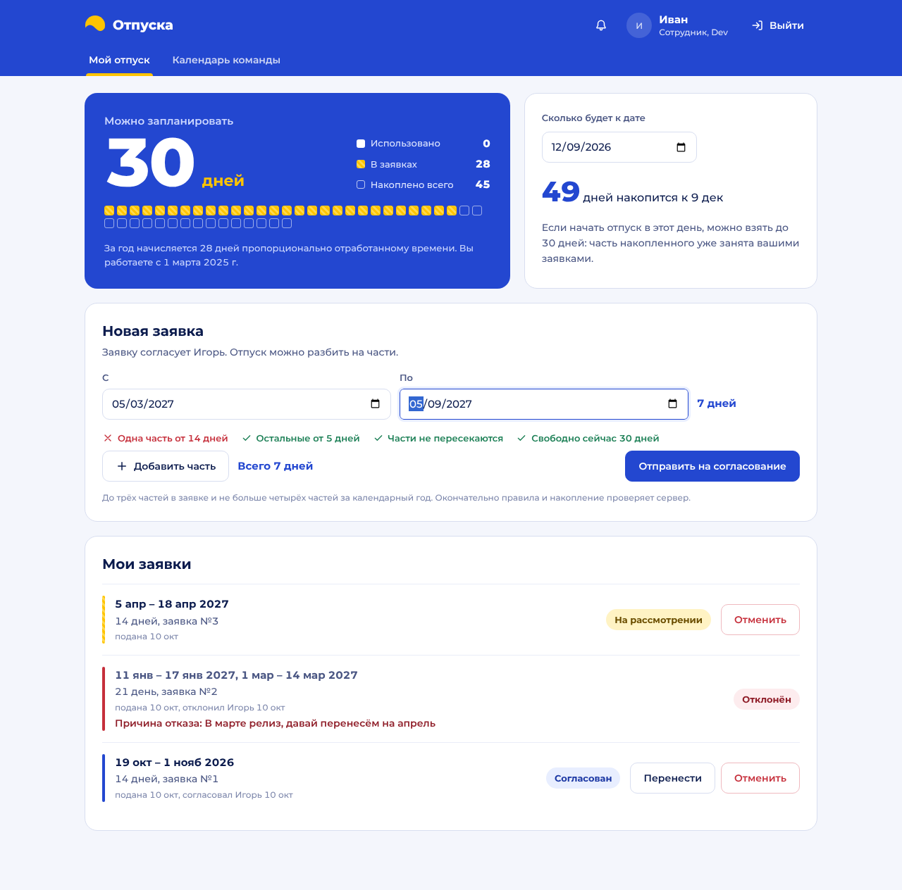
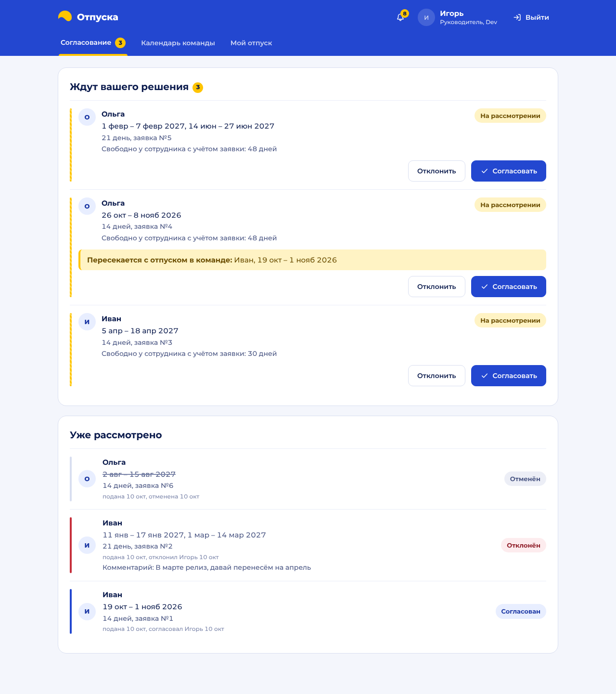
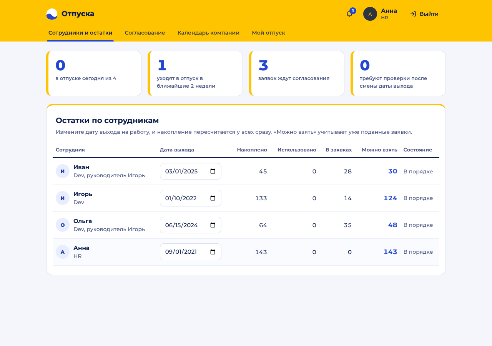

# vacation-tracker — сервис учёта отпусков (задание 13)

Сотрудник видит, сколько дней отпуска ему положено и сколько ещё можно запланировать, и подаёт заявку (целиком или частями). Руководитель согласует или отклоняет с комментарием и видит пересечения с отпусками команды и остаток сотрудника. HR видит календарь всей компании и остатки по сотрудникам. Календари и списки обновляются у всех без перезагрузки страницы.

| Сотрудник | Руководитель | HR |
|---|---|---|
|  |  |  |

Ещё скриншоты: [вход](docs/screenshots/login.png), [календарь компании](docs/screenshots/hr-calendar.png), [календарь команды](docs/screenshots/team.png), [уведомления](docs/screenshots/bell.png), [телефон 390 px](docs/screenshots/mobile.png).

## Чем делали и почему
Разработчик: Camilla Abdulla.
- **Этапы 1–10 (основная разработка): Claude Sonnet 5.5 в claude.ai (чат).** Быстро итерируется по предметным правилам и сразу запускает код и тесты в своей среде.
- **Этап 11 (аудит перед сдачей, доработка дизайна и backend): Claude Opus 5.5 в Claude (агентный режим с облачной Linux-средой).** Нужна была модель, которая прочитает весь проект целиком и сверит его с требованиями, а среда, где в одной сессии можно поднять настоящий PostgreSQL, прогнать тесты, открыть интерфейс в Chromium и снять скриншоты.

Ход решений, ошибок ИИ и проверок — в [`DEVLOG.md`](DEVLOG.md).

## Быстрый запуск
**Нужны:** Python 3.10 или новее и Node.js 20 или новее. Docker и отдельный PostgreSQL не нужны.

- **Windows:** дважды щёлкните `start.bat` (или запустите из cmd). Откроются два окна: backend `:8000` и frontend `:5173`. Первый запуск 1–3 минуты. Встроенный PostgreSQL нельзя запускать от имени администратора.
- **macOS / Linux:** `./start.sh` (один терминал, остановка Ctrl+C; если нет права на запуск, `bash start.sh`). Другой интерпретатор: `PYTHON=/путь/к/python ./start.sh`.

Откройте http://localhost:5173. Демо-аккаунты (пароль `demo`, на экране входа есть кнопки быстрого входа): `ivan`, `olga` — сотрудники; `boss` — руководитель; `hr` — HR. Проверка двух клиентов: откройте две вкладки, например `ivan` и `boss`, и подайте заявку от Ивана — у руководителя она появится сама.

**Проверка backend:** http://localhost:8000/api/v1/health (поле `db`: `postgres-embedded`, `postgres` или `sqlite`); документация API: http://localhost:8000/docs.

**Вручную (cmd):** `cd backend`, `py -3.12 -m venv .venv`, `.venv\Scripts\pip install -r requirements.txt`, `.venv\Scripts\python -m uvicorn app.main:app --port 8000`; в другом окне `cd frontend`, `npm.cmd install`, `npm.cmd run dev`.

**База данных.** Порядок выбора: `DATABASE_URL` (свой PostgreSQL) → встроенный PostgreSQL (пакет `pixeltable-pgserver`, данные в `.pgdata/`) → запасной SQLite (`.vacation.sqlite3`), если встроенный не стартовал (на одном Windows он падал с кодом `0xC0000135`) или задано `VAC_DB=sqlite`. Запасной режим виден в консоли, в `/health` и в жёлтой полосе интерфейса. При заданном `DATABASE_URL` запасного режима нет, ошибка подключения видна сразу.

**Настройки (переменные окружения):**

| Переменная | По умолчанию | Что делает |
|---|---|---|
| `DATABASE_URL` | — | свой PostgreSQL вместо встроенного |
| `VAC_DB=sqlite` | — | сразу запасной SQLite |
| `REMIND_DAYS` | 3 | за сколько дней до начала напоминать |
| `CORS_ORIGINS` | `http://localhost:5173`, `:4173` и то же на `127.0.0.1` | с каких адресов frontend можно обращаться к API (через запятую) |
| `LOGIN_MAX_FAILS`, `LOGIN_WINDOW` | 5, 300 | неудачных попыток входа на один логин за столько секунд, потом 429 |
| `VITE_API` (frontend) | `http://localhost:8000/api/v1` | адрес API |

## Стек и почему
- **Backend: Python + FastAPI + psycopg 3.** Типизированные схемы запросов, автодокументация `/docs`, чистый SQL без ORM: нужны пересечение интервалов, `on conflict do nothing`, `select ... for update`, `pg_notify`.
- **Frontend: React + Vite + TypeScript**, отдельное приложение: общается с backend по HTTP/JSON и SSE. Шрифт Montserrat подключён пакетом (интернет не нужен). У HR жёлтая шапка, у остальных синяя; в календаре синий — согласовано, жёлтый со штриховкой — на рассмотрении. Главный образ — полоса плиток «один день = одна плитка»: использованные, занятые заявками и свободные дни видны сразу.
- **БД: PostgreSQL.** Встроенный запускается самим backend, чтобы не требовать Docker. Версионированные SQL-миграции (`backend/app/migrations/`) вместо Alembic: в проекте нет SQLAlchemy, а одни и те же файлы должны работать и на PostgreSQL, и на SQLite.
- **Реальное время:** SSE поверх Postgres `LISTEN/NOTIFY` (слушатель сам переподключается после обрыва); в режиме SQLite — вызов внутри процесса.
- **Вход:** логин и пароль (PBKDF2 с солью), токен хранится в БД в виде SHA-256, срок 7 дней, перезапуск backend не разлогинивает; после 5 неудачных попыток за 5 минут логин временно блокируется (429).

## Правила предметной области
- **Накопление:** `floor(28 × отработанные_дни / 365)`. Остаток не хранится, а считается функцией, поэтому смена даты выхода пересчитывает всё сразу.
- **Сколько можно взять.** «Накоплено − использовано» вводит в заблуждение, если уже есть будущие заявки: они займут дни, которые накопятся к их началу. Поэтому backend отдаёт `free` — сколько дней ещё можно запланировать с указанной даты, не нарушив покрытие ни одной поданной заявки. Это число крупно показано сотруднику, руководителю в карточке заявки и HR в таблице.
- **Заявка:** до 3 частей; хотя бы одна от 14 дней, остальные от 5; части не пересекаются; задним числом нельзя. Нарастающий итог дней по хронологии не должен превышать накопленное к началу каждой части. В календарном году (по дате начала части) не больше 4 частей по заявкам «на рассмотрении» и «согласован» (число 4 выбрано мной, в задании его нет). Форма подсвечивает правила дробления по мере ввода; окончательно всё проверяет сервер, его ошибка показывается в самой форме.
- **Согласование:** решает руководитель сотрудника; для сотрудников без руководителя (в демо это `boss`) — HR, но не сам себе. Форма заранее пишет, кто согласует. Если согласовать некому, заявка не принимается с понятной ошибкой. Отклонение требует комментария. Руководитель видит пересечения с уже согласованными отпусками команды. Решение атомарно: второй одновременный запрос получает 409. В заявке сохраняется, кто и когда решил.
- **Уведомления:** согласующему — о новой заявке и об отмене, сотруднику — о решении, по одному. «Ровно одно» гарантирует `unique(type, vacation_id, recipient_id)` в БД. Почта эмулируется: запись в БД и строка `[почта]` в логе backend; текст самодостаточный (кто, даты, число дней). У колокольчика счётчик непрочитанных.
- **Напоминание:** фоновая задача раз в минуту; когда до начала согласованного отпуска осталось не больше `REMIND_DAYS` дней, сотрудник и согласующие получают по одному напоминанию (не теряется, если backend не работал в нужный день).
- **Отмена и перенос:** до начала возвращаются все дни, после начала у согласованного отпуска остаётся использованное по день отмены включительно; так и не согласованная заявка дни не расходует. Даты отменённой заявки остаются в истории (зачёркнуты). Перенос — атомарно «отмена старой + новая заявка на согласование».
- **Смена даты выхода (HR):** остаток пересчитывается сразу; дата в будущем не принимается. Заявки, которые перестали покрываться накоплением, сами не отменяются: сотрудник, руководитель и HR получают по одному уведомлению на заявку, у HR в таблице пометка с причиной.
- **Одновременные клиенты:** любое изменение приходит остальным по SSE; две одновременные заявки одного сотрудника выстраиваются блокировкой строки и не обходят проверку остатка.

## Как проект доказывает работоспособность
- **53 теста backend** (`cd backend && python -m pytest -v`): правила, интеграционные на реальном HTTP-сервере и БД, гонки, SSE между двумя сессиями, напоминания, миграции, сессии, лимит входа, переход на SQLite. Тесты сами поднимают временную БД. Те же тесты на SQLite: `VAC_DB=sqlite python -m pytest -v` (52 + 1 пропущенный: LISTEN есть только в PostgreSQL). Вывод — [`TEST_RESULTS.txt`](TEST_RESULTS.txt).
- **6 сквозных тестов интерфейса** в Chromium (Playwright, `e2e/`, инструкция в `e2e/README.md`): ошибка правил в форме, заявка → руководитель без перезагрузки, отказ с причиной, правка даты выхода у HR, счётчик уведомлений, подсказки правил и отмена с уведомлением руководителю, мобильная ширина. Вывод — [`E2E_RESULTS.txt`](E2E_RESULTS.txt).
- **CI:** `.github/workflows/ci.yml` при каждом push запускает тесты backend на PostgreSQL и SQLite, сборку frontend и сквозные тесты интерфейса; скриншоты сохраняются артефактом.
- **План и результаты:** [`docs/TEST_PLAN.md`](docs/TEST_PLAN.md); API — [`docs/API.md`](docs/API.md); схема БД — [`docs/DATABASE.md`](docs/DATABASE.md).

## Состояние проекта (честно)
**Работает и проверено** (облачная среда Claude, Linux, Python 3.13, Node 22, 10.10.2026): все требования задания; 53 теста на встроенном PostgreSQL 18 и 52 + 1 пропущенный на SQLite; 6 сквозных тестов интерфейса на текущей версии (на PostgreSQL с демо-данными и дважды подряд на чистой SQLite, как в CI); `npm ci` и `npm run build`; `start.sh` с нуля в чистой копии репозитория; перезапуск backend: сессия и данные сохраняются (T14); обновление старой БД новой миграцией 004.

**Не проверено:**
- Запуск `start.bat` на Windows после последних правок; запасной SQLite на Windows не запускался.
- Сам прогон CI на GitHub (YAML проверен, шаги e2e-задачи повторены локально теми же командами).
- Другие браузеры, экранные читалки, SQLite при нескольких процессах backend.

**Известно и сделано сознательно:**
- Перенос сразу отменяет старый отпуск: если новую заявку отклонят, старый сам не вернётся, придётся подавать заново.
- HR без руководителя и без другого HR согласовать свою заявку некому: сервис честно отвечает ошибкой.
- Годовой лимит частей, число 4, выбрано разработчиком, в задании его нет.
- Праздники считаются днями отпуска (производственного календаря нет).
- Нет откатов миграций, нет тестов отдельных React-компонентов.
- Безопасность: лимит неудачных входов хранится в памяти процесса (при нескольких процессах backend он у каждого свой); токен SSE передаётся в адресе (`EventSource` не умеет заголовки). Встроенный PostgreSQL на одном Windows (Python 3.14) не запустился (`postgres.exe` → `0xC0000135`), причина не установлена.

## Что сделали бы следующим заходом
- Прогнать продукт на Windows с обычным PostgreSQL без запасного режима.
- Перенос без потери старого отпуска: оставлять старый до решения по новой заявке.
- Производственный календарь (праздники не считать днями отпуска), многоуровневое согласование.
- Лимит входа и SSE через общий store (Redis или БД) для нескольких процессов; короткоживущий токен для SSE вместо основного; JWT или SSO; реальная отправка почты.
- Автоматический пересмотр заявок после смены даты выхода с повторным согласованием (сейчас решение за человеком).
- Админка для сотрудников и команд (сейчас 4 демо-пользователя создаются при первом старте).

## Что взято со стороны
Готовых решений, генераторов и чужих шаблонов кода нет: код, тесты и интерфейс написаны агентом с нуля. Структура документов (DEVLOG, API, БД, план тестов) следует шаблонам, которые разработчик передал агенту (DEVLOG, запись 8). Структура frontend стандартная для Vite. Зависимости: см. `backend/requirements.txt` (FastAPI, uvicorn, psycopg, pixeltable-pgserver — форк `pgserver`, httpx, pytest) и `frontend/package.json` (React, Vite, TypeScript, шрифт Montserrat); для e2e — Playwright.

## Ход работы во времени
Решения, ошибки ИИ и проверки по этапам — в [`DEVLOG.md`](DEVLOG.md). Настоящие метки времени дают история коммитов GitHub, раздел DEVLOG «Записи по ходу работы» (команда `python scripts/log.py "что сделал"`, с `--commit` она же делает коммит) и метки этапа 11, снятые часами среды во время работы. Время этапов 1–10 в чате не фиксировалось и задним числом не подставлялось.

## Структура
```
backend/app/      main.py (API), rules.py (правила), db.py (БД), migrations/*.sql
backend/tests/    юнит- и интеграционные тесты
frontend/src/     React-приложение (экраны, календарь, API-клиент)
e2e/              сквозные тесты интерфейса (Playwright)
docs/             API, схема БД, план тестов, скриншоты
scripts/log.py    запись в DEVLOG с реальным временем
start.bat, start.sh   запуск (Windows; macOS/Linux)
```
